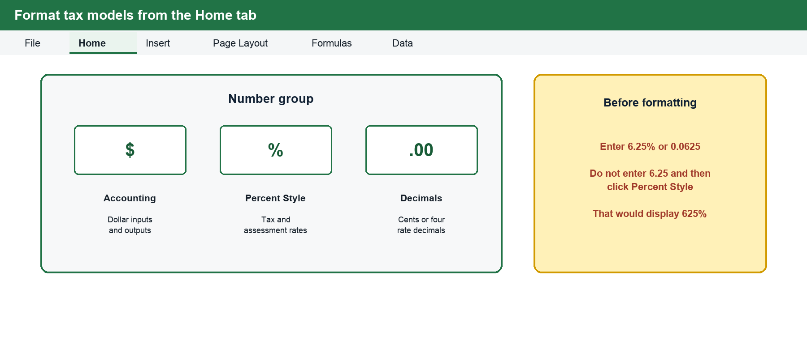
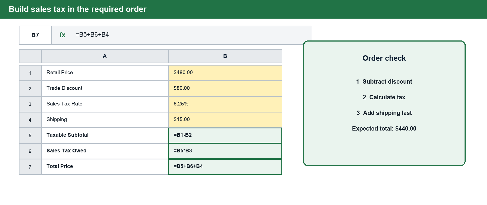
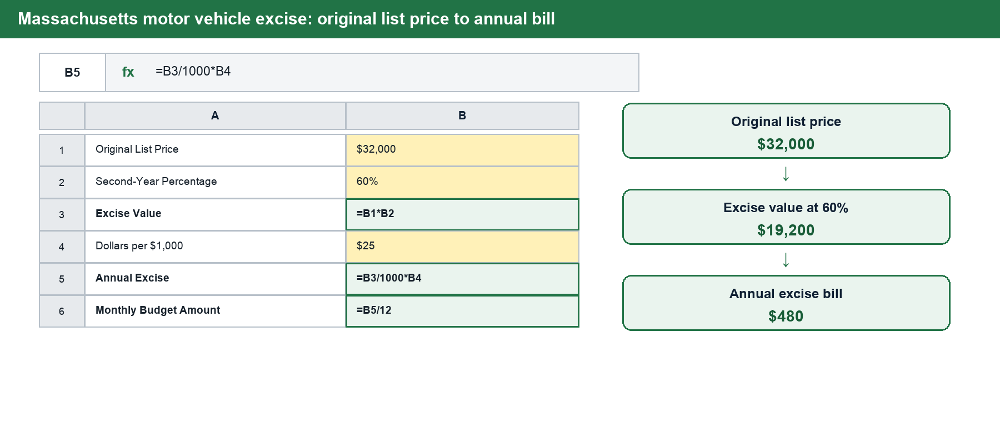
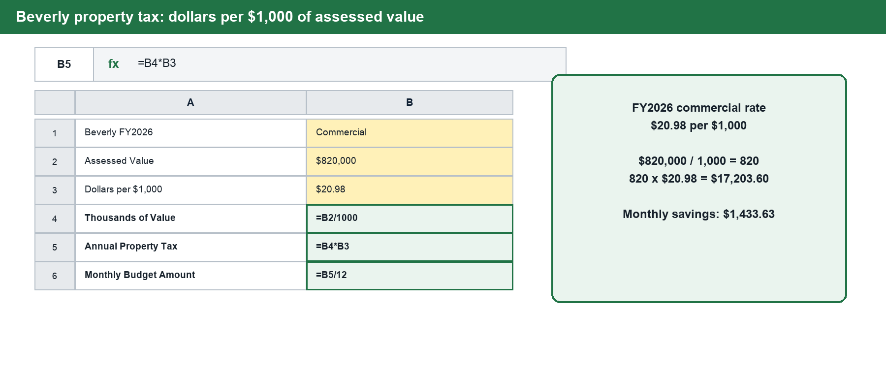

# BUS 123 · MATH-M07-L01 · Sales, Excise & Property Taxes

**Course:** Solving Business Problems with Technology · Fall 2026
**Track:** MATH · **Module:** M07 · **Lesson:** L01
**Case Study Companies:** Tidal Goods Co. · Meridian Advisory Group

---

## 1 · Connect to Prior Knowledge

In the previous module, you learned how businesses set selling prices — applying trade discounts to reduce the retail price before quoting a buyer, and marking up costs to establish a profitable price point. You built those calculations in Excel using cell references so that any change in an input automatically updated the entire chain.

This lesson adds a critical layer: **government taxes.** Once a price is set, taxes are applied at specific points in a defined order — and getting that order wrong produces incorrect totals, incorrect revenue reporting, and potential legal liability. Today we examine three distinct tax types — sales, excise, and property — each of which places a different obligation on the business.

> 📘 **Training Jurisdiction Rules**
>
> Tax rules vary by location. To keep the lesson focused on business math, sales examples use Massachusetts’s 6.25% rate, vehicle excise uses Massachusetts rules, and property tax uses Beverly’s published FY2026 rates:
> - qualifying trade discounts reduce the sales-tax base;
> - shipping is added after sales tax;
> - motor vehicle excise is a separate annual city/town bill to the registered owner; use original manufacturer list price, the vehicle-year percentage, and $25 per $1,000;
> - property uses the assessor’s full and fair cash value and the local dollar rate per $1,000; example building values are illustrative, with no exemptions assumed.
>
> Treat these as the supplied rules for the lesson, not as universal tax advice.

---

## 2 · Core Concepts

### Part 1 — Sales Tax

#### What Is Sales Tax?

Sales tax is a consumption tax imposed on specified retail sales. Rates and taxable items vary by jurisdiction. In this lesson, the problem statement always supplies the rate and the taxable-base rules you should use.

> ⚠️ **The Merchant's Role**
>
> When a business collects sales tax from a customer, those funds are **NOT revenue**. They are a **liability held in trust** for the state government. The business is acting as a collection agent. Misclassifying collected tax as earned revenue is a serious accounting error.

#### The Order of Operations

For this lesson's training jurisdiction, trade discounts reduce the taxable base and shipping is added after tax. Reversing the supplied sequence produces an incorrect result.

| Step | Operation                              | Formula                              |
|------|----------------------------------------|--------------------------------------|
| 1    | Subtract trade discount from retail price | `Taxable = Price − Discount`      |
| 2    | Apply tax rate to taxable subtotal     | `Tax = Taxable × Rate`               |
| 3    | Add shipping to get total price        | `Total = Taxable + Tax + Shipping`   |

#### Worked Example — Tidal Goods Co.

Tidal Goods Co. sells a bulk supply order to a business customer for its own use. Retail price: $480.00. Trade discount: $80.00. Sales tax: 6.25%. Flat shipping: $15.00.

| Item                       | Amount    |
|----------------------------|-----------|
| Retail Price               | $480.00   |
| Less: Trade Discount       | −$80.00   |
| **Taxable Subtotal**       | **$400.00** |
| × Sales Tax Rate (6.25%)      | × 0.0625  |
| Tax Owed                   | $25.00    |
| Taxable Subtotal + Tax     | $425.00   |
| + Shipping                 | +$15.00   |
| **Total Price**            | **$440.00** |

#### Back-Calculating Actual Sales

When a retailer's register total includes both sales revenue and collected tax, the actual pre-tax revenue must be isolated:

**`Actual Sales = Total Receipts / (1 + Tax Rate)`**

**Example:** Tidal Goods Co.'s register shows $52,000 in total daily receipts at a 6.25% tax rate.
- Actual sales = $52,000 ÷ 1.0625 = **$48,941.18**
- The remaining **$3,058.82** belongs to the state.

---

### Part 2 — Massachusetts Motor Vehicle Excise

#### Who Pays?

The registered vehicle owner — a person or a company — receives an annual excise bill from the city or town. The owner pays the local tax collector. This bill is separate from sales tax on the vehicle purchase.

#### Which Value Do We Use?

Use the **manufacturer’s original list price**, not purchase price or current resale value. Multiply it by the percentage for the vehicle’s year:

| Vehicle year | Percentage of original list price |
|---|---|
| Year of manufacture | 90% |
| Second year | 60% |
| Third year | 40% |
| Fourth year | 25% |
| Fifth year and later | 10% |

The excise rate is **$25 per $1,000 of excise value**. These examples assume registration for the full calendar year, with no exemptions or abatements. Actual bills can be prorated; the DOR guide explains the rules.

#### Worked Example — Meridian’s Company Car

Meridian owns a car with an original manufacturer list price of **$32,000**, in its **second year**. It is registered for the full calendar year.

| Step | Excel formula | Calculation |
|---|---|---|
| Excise value | `=B1*B2` | $32,000 × 60% = **$19,200** |
| Annual excise bill | `=B3/1000*B4` | $19,200 ÷ 1,000 × $25 = **$480** |
| Monthly amount to set aside | `=B5/12` | $480 ÷ 12 = **$40** |

B1 is original list price, B2 is the year percentage, B3 is excise value, B4 is dollars per $1,000, and B5 is the annual bill. The monthly amount is a budgeting choice; the tax bill is annual.

[Source: Massachusetts DOR — Motor Vehicle Excise](https://www.mass.gov/guides/motor-vehicle-excise)

---

### Part 3 — Massachusetts Property Tax: Beverly

The property owner pays the city or town. In Massachusetts, the local assessor determines **full and fair cash value**. Use that assessed value directly; do not multiply it by a 32% or 40% assessment fraction.

Beverly’s **FY2026** rates are **$20.98 per $1,000 for commercial property** and **$10.81 per $1,000 for residential property**. Rates vary by municipality, property class, and fiscal year.

#### Worked Example — Meridian’s Illustrative Beverly Office

Assume a commercial office assessed at **$820,000**, with no exemptions. This is an example value, not a claim about a specific parcel.

| Step | Excel formula | Calculation |
|---|---|---|
| Thousands of assessed value | `=B2/1000` | $820,000 / 1,000 = **820** |
| Annual property tax | `=B4*B3` | 820 × $20.98 = **$17,203.60** |
| Monthly amount to set aside | `=B5/12` | $17,203.60 / 12 = **$1,433.63** |

B2 is assessed value, B3 is dollars per $1,000, B4 is thousands of value, and B5 is annual tax. The equivalent direct formula is `=B2/1000*B3`. Monthly savings are a budgeting choice, not the city’s billing schedule.

**Check the units:** $20.98 is a dollar amount per $1,000, not a percentage. **Check the class:** Meridian’s office uses the commercial rate, not the residential rate.

Sources: [Beverly City Assessors — FY2026 rates](https://www.beverlyma.gov/391/City-Assessors) and [Massachusetts DOR — Municipal Property Taxes](https://www.mass.gov/guides/massachusetts-municipal-property-taxes).

---

## 3 · Build the Tax Models in Excel

Excel should mirror the order of the business calculation. Keep every assumption in its own labeled input cell, then build formulas that reference those cells. In the examples below, **yellow cells are inputs** and **green cells are formulas**.

> 💻 **Windows and Mac Excel**
>
> The images show Windows Excel. Mac Excel uses the same commands and formula syntax, although a button may appear in a slightly different position on the ribbon.

### Format Dollar Amounts and Rates

Use **Home → Number** to format prices, taxes, and totals as Accounting or Currency. Format sales-tax rates and vehicle-year percentages as percentages. Keep property-tax rates per $1,000 as dollar amounts. Enter `6.25%` or `0.0625`—do not enter `6.25` and then click Percent Style, because Excel would display `625%`.

### Walkthrough 1 — Build the Sales Tax Formula Chain

Set up this model in a blank area of Excel. The cell addresses below are an example; the important requirement is that your formulas reference the cells containing the inputs.

1. **Set up:** In column A, enter the labels Retail Price, Trade Discount, Sales Tax Rate, Shipping, Taxable Subtotal, Sales Tax Owed, and Total Price. In cells B1:B4, enter `$480`, `$80`, `6.25%`, and `$15`.
2. **Select and type:** Select B5 and type `=B1-B2`. Select B6 and type `=B5*B3`. Select B7 and type `=B5+B6+B4`.
3. **Format:** Format B1:B2 and B4:B7 as Accounting or Currency. Format B3 as Percentage.
4. **Check:** B5 should equal **$400.00**, B6 should equal **$25.00**, and B7 should equal **$440.00**. The total must be greater than the taxable subtotal because tax and shipping were added.
5. **Try:** Change the trade discount in B2 from `$80` to `$100`. The taxable subtotal, tax, and total should all update automatically.

> ⚠️ **Order Matters**
>
> Subtract the trade discount first, calculate tax second, and add shipping last. Do not calculate tax from the original retail price when a trade discount reduces the taxable base.

### Walkthrough 2 — Calculate a Vehicle Owner’s Excise Bill

1. Enter original list price `$32,000` in B1, second-year percentage `60%` in B2, and dollars per $1,000 `$25` in B4.
2. In B3, enter `=B1*B2` to find the **$19,200 excise value**.
3. In B5, enter `=B3/1000*B4` to find the **$480 annual bill**.
4. In B6, enter `=B5/12` to find the **$40 monthly budgeting amount**.
5. Change B2 to `40%` for the third year. Excise value falls to **$12,800**, annual excise to **$320**, and the monthly amount displays **$26.67**. The $25-per-$1,000 rate does not change.

### Walkthrough 3 — Use Beverly’s Published Commercial Rate

1. Enter assessed value `$820,000` in B2 and the FY2026 commercial rate `$20.98` per $1,000 in B3.
2. In B4, enter `=B2/1000`; the result is **820** thousands of value.
3. In B5, enter `=B4*B3`; the annual tax is **$17,203.60**.
4. In B6, enter `=B5/12`; the monthly amount to set aside displays **$1,433.63**.
5. Change assessed value to `$900,000`, keeping the rate fixed. Annual tax becomes **$18,882** and monthly savings become **$1,573.50**.

## 4 · Formula Reference

| Formula Name                    | Expression                                              |
|---------------------------------|---------------------------------------------------------|
| **Sales Tax — Taxable Subtotal**| `= Price − Trade Discount`                             |
| **Sales Tax — Tax Owed**        | `= Taxable × Tax Rate`                                 |
| **Sales Tax — Total Price**     | `= Taxable + Tax + Shipping`                           |
| **Back-Calculate Actual Sales** | `= Total Receipts / (1 + Tax Rate)`                   |
| **Vehicle excise value** | `=ListPrice*YearPercent` |
| **Annual vehicle excise** | `=ExciseValue/1000*25` |
| **Property — Thousands of Value** | `=AssessedValue/1000` |
| **Property — Annual Tax** | `=ThousandsOfValue*LocalRate` |
| **Property — Monthly Savings** | `=AnnualTax/12` |

---

## 5 · Check Your Understanding

Answer all seven questions before class. Answers appear at the end of this document.

**1. [Calculation]** Tidal Goods Co. sells an order priced at $600. The buyer receives a $100 trade discount. Sales tax is 6.25%. Shipping is $18. What is the taxable subtotal and the total price?

**2. [Concept]** A merchant collects $4,200 in sales tax over a week. Is that $4,200 the merchant's revenue? Explain why or why not.

**3. [Calculation]** Register receipts total $78,000 for the day, inclusive of 6.25% sales tax. What were the actual pre-tax sales?

**4. [Calculation]** Meridian owns a car with an original list price of $36,000, in its third year. It is registered for the full calendar year. Calculate excise value, annual excise, and a monthly amount to set aside.

**5. [Concept]** Why should the owner use the manufacturer’s original list price rather than the car’s purchase price to calculate Massachusetts motor vehicle excise? Who receives payment?

**6. [Calculation]** Meridian’s illustrative Beverly commercial office has an assessed value of $450,000. Use the FY2026 rate of $20.98 per $1,000, assuming no exemptions. Find annual property tax and a monthly amount to set aside.

**7. [Strategy]** Why should a business verify the property class and fiscal year before using a published property-tax rate?

---

### Answer Key · Check Your Understanding

| # | Answer |
|---|--------|
| **1** | Taxable = $600 − $100 = $500. Tax = $500 × 0.0625 = $31.25. Total = $500 + $31.25 + $18 = **$549.25** |
| **2** | No. Collected sales tax is a **liability held in trust** for the state government, not earned revenue. Recording it as revenue overstates income. |
| **3** | $78,000 / 1.0625 = **$73,411.76**. Collected tax = $78,000 − $73,411.76 = $4,588.24. |
| **4** | Excise value = $36,000 × 40% = $14,400. Annual excise = $14,400 / 1,000 × $25 = **$360**. Monthly amount = $360 / 12 = **$30**. |
| **5** | Massachusetts uses original manufacturer list price and a statutory year percentage, not purchase price. The registered owner pays the city/town tax collector. |
| **6** | Annual tax = $450,000 / 1,000 × $20.98 = **$9,441**. Monthly savings = $9,441 / 12 = **$786.75**. |
| **7** | The applicable rate can differ by class and year. Applying a residential rate to a commercial office can understate tax and leave the business short of cash. |

---

## 6 · Key Vocabulary

| Term                          | Definition                                                                                                                                                         |
|-------------------------------|--------------------------------------------------------------------------------------------------------------------------------------------------------------------|
| **Sales Tax**                 | A state-imposed consumption tax on the retail sale of goods and services; collected by merchants on behalf of the government.                                       |
| **Trade Discount**            | A reduction from the retail price given to a business buyer; subtracted **before** sales tax is applied.                                                           |
| **Excise Tax**                | A targeted tax imposed on specified products or activities; the liable party and tax base depend on the governing rule.                                          |
| **Assessed Value** | The local assessor’s estimate of full and fair cash value in Massachusetts. |
| **Local Property-Tax Rate** | Dollars charged per $1,000 of assessed value for the property’s class and fiscal year. |
| **Nexus**                     | The legal connection (physical presence or economic activity) that requires a business to collect and remit sales tax in a given jurisdiction.                     |
| **Business Personal Property**| Movable, tangible operating assets (computers, furniture, machinery) subject to local property tax.                                                               |
| **Excise Value** | Original manufacturer list price multiplied by the percentage for the vehicle year. |
